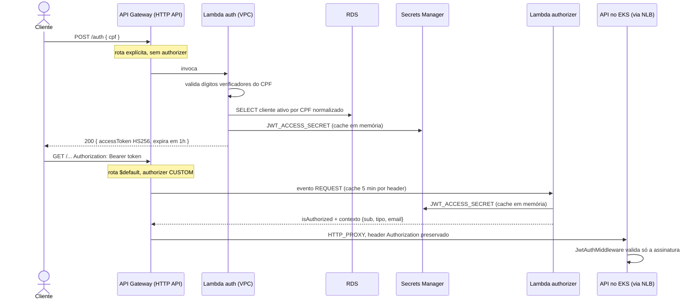

# RFC-003 · Estratégia de autenticação: CPF, Lambda, JWT e authorizer no API Gateway

> [← Voltar ao índice de RFCs](./README.md)

| | |
| --- | --- |
| **Status** | Aceita — decisão já implementada; RFC escrita a posteriori. **Contém uma falha de autorização conhecida e não corrigida** (ver Consequências) |
| **Data do registro** | 19/10/2026 |
| **Escopo** | Como cliente e funcionário provam identidade, quem emite o token, quem o valida e onde |
| **Relacionadas** | [RFC-001](./rfc-001-escolha-da-nuvem.md) · [RFC-002](./rfc-002-banco-gerenciado.md) · [Contrato da Fase 3](../14-fase3-contrato.md), seção 4 |

> **Sobre as fontes.** O fluxo descrito foi lido em `lambda-auth/src`, `lambda-auth/terraform` e `app-oficina/src`; nada foi executado para escrever esta RFC. A seção de falha de autorização relata o que o código **diz**, com caminho e linha, e separa explicitamente o que foi lido do que seria inferência de comportamento em runtime. As opções alternativas são avaliação a posteriori, sem registro de época.

## Contexto

Desde a Fase 1, o funcionário (mecânico, atendente, admin) se autentica por e-mail e senha na própria API: `POST /auth/login` devolve um par access/refresh JWT (`app-oficina/src/auth/auth.service.ts:20-50`), e um `JwtAuthMiddleware` global valida o Bearer em todas as rotas, com poucas exceções públicas (`app-oficina/src/app.module.ts:43-58`; `docs/01-arquitetura.md`, seção "Autenticação e autorização").

A Fase 3 introduziu um caminho de login para um segundo ator, o **cliente da oficina**, que não tem e-mail e senha no sistema. O que o cliente possui, e que já está no banco, é o CPF/CNPJ (`prisma/schema.prisma:59-74`, `numDocumento` único). Antes disso, o cliente só tinha rotas públicas autenticadas pelo documento na query (`docs/01-arquitetura.md`, tabela de exceções públicas). A fronteira pública também mudou: entrou um API Gateway na frente do cluster (`lambda-auth/terraform/api_gateway.tf:1-7`).

Duas necessidades, então: (1) emitir um token para o cliente a partir do CPF; (2) barrar token inválido **antes** de a requisição chegar ao cluster, sem quebrar o login do funcionário, que já existia e emite um token de formato diferente.

## Opções consideradas

| Opção | Descrição | Leitura |
| --- | --- | --- |
| **A. CPF -> Lambda -> JWT + Lambda authorizer (escolhida)** | Função serverless troca CPF por JWT HS256; o gateway valida cada requisição protegida com um authorizer Lambda; a API revalida | Implementada. Mantém o login do funcionário intacto |
| **B. Só middleware na API** | Gateway apenas repassa; toda validação fica no `JwtAuthMiddleware` | Era o estado anterior para o funcionário (`lambda-auth/src/authorizer.ts:62-63`). Não barra requisição inválida antes do cluster e não dá ao cliente um caminho de login |
| **C. JWT authorizer nativo do HTTP API** | O próprio gateway valida o token, sem Lambda | A posteriori. Pelo que se sabe do serviço, ele valida tokens de um emissor OIDC com chaves públicas (JWKS), o que não casa com o HS256 de segredo compartilhado que os dois tokens do sistema já usam. **Não foi testado nem registrado como motivo na época** |
| **D. Amazon Cognito** | Pool de usuários gerencia emissão e validação | A posteriori. Exigiria migrar a base de funcionários e modelar o CPF como identidade, provavelmente com gatilhos Lambda de qualquer forma. Não há registro de que tenha sido considerada |
| **E. Chave assimétrica (RS256) em vez de segredo compartilhado** | Quem emite assina com a privada; quem valida só tem a pública | A posteriori. Reduziria o impacto de vazamento do segredo (ver Consequências), a custo de mudar o login do funcionário, que também assina com `JWT_ACCESS_SECRET` |

O repositório não registra a comparação. O que o código declara como razões da escolha A:

- O authorizer roda **fora da VPC** e só lê segredo e verifica JWT; barra requisição inválida antes do cluster (`lambda-auth/terraform/authorizer.tf:1-5,69-72`).
- Uma chave única, num lugar só, lida por quem assina e por quem valida: "se cada um gerasse a própria chave, todo token emitido seria recusado na porta de entrada" (`infra-db/terraform/secrets.tf:1-7`).
- O authorizer aceita **os dois formatos de token** que circulam, porque exigir `tipo: 'CLIENTE'` barraria todo funcionário no gateway (`lambda-auth/src/authorizer.ts:54-70`).

## Decisão

**O cliente se autentica por CPF numa Lambda que emite um JWT HS256; o API Gateway valida o JWT de toda rota protegida com um authorizer Lambda; a API revalida a assinatura.** O funcionário continua usando `POST /auth/login` da API, que é rota pública no gateway.

### Fluxo

### 1. Login do cliente: `POST /auth` (`lambda-auth/src/handler.ts`)

| Passo | Comportamento | Linhas |
| --- | --- | --- |
| Parse | Corpo não JSON -> 400; sem `cpf` -> 400 | `handler.ts:62-75` |
| Normalização e DV | Remove não dígitos; valida os dois dígitos verificadores e rejeita sequências repetidas **antes** de abrir conexão com o banco | `handler.ts:77-82`; `cpf.ts:1-46` |
| Busca | SQL parametrizado, com `regexp_replace` na coluna (a aplicação grava o documento com pontuação) e `deletado_em IS NULL` | `cliente.ts:62-90` |
| Inexistente ou inativo | **401 genérico**, indistinguível entre os dois casos | `handler.ts:86-99` |
| Emissão | `jwt.sign` HS256, `expiresIn: '1h'`, payload `{ sub: clienteId (UUID), nome, email, tipo: 'CLIENTE' }` | `handler.ts:12-13,101-113` |
| Resposta | `{ accessToken, expiresIn: 3600, tokenType: 'Bearer' }`; erro interno nunca vaza detalhe | `handler.ts:121-136` |

A função roda na VPC para alcançar o RDS (`main.tf:76-82`); o segredo é lido do Secrets Manager em runtime e cacheado em memória como *Promise*, com o cache descartado se a leitura falhar (`config.ts:21-70`). Só o **nome** do segredo vai para o ambiente da função (`main.tf:84-92`).

### 2. Roteamento no gateway (`lambda-auth/terraform/api_gateway.tf`)

- `POST /auth` é rota explícita **sem** authorizer: exigir token na rota que emite token seria circular (`:102-107`).
- Rotas públicas explícitas, que têm precedência sobre `$default`: `GET /health/*`, `POST /auth/login`, `POST /auth/refresh`, `GET /publico/*`, `GET|POST /aprovacao/*` (`:9-31`). Sem elas o funcionário não conseguiria logar e os links de aprovação por e-mail dariam 401 no gateway.
- Todo o resto cai em `$default` com `authorization_type = "CUSTOM"` e o authorizer JWT (`:170-188`).
- O authorizer é do tipo `REQUEST`, payload 2.0, respostas simples, lendo o header `Authorization`, com **cache de 300 s** por valor do header (`:119-133`).
- As rotas da API só existem com `api_nlb_hostname` preenchido, e a integração é HTTP direto para o NLB (`:36-38,153-179`; `variables.tf:53-67`).

### 3. Validação no gateway: o authorizer (`lambda-auth/src/authorizer.ts`)

1. Lê o header em **minúsculo** (o payload 2.0 normaliza os nomes) e exige `Bearer` (`:36-52`).
2. `jwt.verify` com `algorithms: ['HS256']` explícito, o que fecha `alg: none` e troca de algoritmo (`:108-113`). Testes cobrem `none`, HS512 com a chave certa, chave errada e expirado (`test/authorizer.spec.ts:110-130,165-183`).
3. Monta o contexto: exige `sub` string não vazia ou número finito; aceita `tipo` ausente (tratado como `FUNCIONARIO`) ou `'CLIENTE'`; **qualquer outro `tipo` é recusado** (`:71-92`).
4. Recusa devolve só `{ isAuthorized: false }`; o motivo vai para o log, nunca para a resposta, para o gateway não virar oráculo de forja de token (`:28-34,124-132`).

### 4. Revalidação na API

O `JwtAuthMiddleware` cobre todas as rotas (`forRoutes('*')`), exceto as públicas (`app.module.ts:43-58`), e valida a assinatura com `JWT_ACCESS_SECRET` (`middleware/jwt-auth.middleware.ts:24-40`). O `JWT_ACCESS_SECRET` que a API recebe é o mesmo do Secrets Manager, materializado em `Secret/api-secrets` no deploy (`deploy.yml:105-131`). Como o `infra-db` compõe `JWT_ACCESS_SECRET` e `JWT_REFRESH_SECRET` junto da `DATABASE_URL` num único segredo, `tech-challenge-fiap/api` (`secrets.tf:9-17,42-55`), a chave é a mesma para Lambda de login, authorizer e API.

### Os dois formatos de token

| | Cliente | Funcionário |
| --- | --- | --- |
| Emissor | `POST /auth`, Lambda (`handler.ts:103-113`) | `POST /auth/login`, API (`auth.service.ts:95-112`) |
| Payload | `{ sub: <uuid>, nome, email, tipo: 'CLIENTE' }` | `{ sub: <number>, email, roles }`, sem `tipo` (`auth/types/jwt-payload.interface.ts:3-7`) |
| Validade do access token | 1 h (`handler.ts:13`) | 15 min (`k8s/10-configmap.yaml:12`) |
| Refresh token | não existe | 7 dias, com hash bcrypt no banco, rotação e revogação por logout (`10-configmap.yaml:23`; `auth.service.ts:52-83,114-123`) |

O refresh token do funcionário é assinado com `JWT_REFRESH_SECRET`, chave **diferente** da de acesso, então não passa como access token no authorizer nem no middleware.

## Consequências

### Positivas

- **Falha fechada e sem vazamento de motivo.** Qualquer erro no authorizer, inclusive segredo que não carrega, vira recusa (`authorizer.ts:124-132`; teste em `authorizer.spec.ts:204-212`).
- **Algoritmo fixado** no authorizer e testado contra `alg: none` e HS512 (`authorizer.ts:108-113`).
- **Menor privilégio por função.** O authorizer tem role própria, só com escrita de logs e leitura do segredo, e fica fora da VPC, sem pagar ENI no cold start (`authorizer.tf:14-49,69-72`).
- **Nenhum dado pessoal em log.** CPF só mascarado (`***` + 3 dígitos), token e segredo nunca logados; o access log do gateway não inclui headers (`logger.ts:9-12,43-46`; `api_gateway.tf:71-72`).
- **Validação barata antes do banco.** O dígito verificador roda antes de abrir conexão, o que importa numa rota pública com RDS `db.t4g.micro` (`cpf.ts:1-8`; `cliente.ts:11-19`).
- **Login do funcionário preservado**, sem migração (`authorizer.ts:54-70`).

### Negativas e riscos conhecidos

#### 1. Falha de autorização conhecida: a API valida a assinatura, não o payload

**O que foi verificado no código de `app-oficina/src`:**

| Fato | Evidência |
| --- | --- |
| O middleware chama `verifyAsync<JwtPayload>(token, { secret })`. O tipo genérico é só anotação de compilação: nada checa `roles`, `tipo` ou o formato de `sub` em runtime. O resultado vai direto para `req.user`. | `src/middleware/jwt-auth.middleware.ts:33-37` |
| Não há `algorithms` em nenhum `verify` da API. | busca por `algorithms` em `src/`: zero ocorrências |
| **Não existe nenhum guard, decorator de papel ou metadata de autorização.** Busca por `Guard`, `UseGuards`, `CanActivate`, `APP_GUARD`, `@Roles`, `SetMetadata`, `Reflector` em `src/`: zero ocorrências. | `src/` |
| `roles` é **produzido** (assinado no token, persistido) e **nunca consultado** para decidir acesso. O enum `Roles` tem `admin`, `funcionario`, `mecanico`. | `auth.service.ts:37,47,71`; `prisma/schema.prisma:13-17,43` |
| O tipo declarado do payload é `{ sub: number; email: string; roles: Roles }`. O token de cliente tem `sub` UUID, sem `roles`, com `tipo`. O próprio `lambda-auth` registra isso como "ponto de integração em aberto". | `auth/types/jwt-payload.interface.ts:3-7`; `lambda-auth/src/handler.ts:21-26` |
| O teste do middleware usa `roles: ['admin']` (array) contra o tipo `Roles` (escalar): o payload nunca é validado, nem no teste. | `src/middleware/jwt-auth.middleware.spec.ts:58` |

**O que o gateway não compensa:**

- O authorizer delega: "a autorização fina (roles, dono do recurso) continua sendo da API; o gateway só garante que o token é nosso e está válido" (`authorizer.ts:68-69`). Mas a API não a faz.
- O contexto que o authorizer monta (`{ sub, tipo, email }`) **não chega à API**: as integrações `HTTP_PROXY` não declaram `request_parameters` (`api_gateway.tf:153-179`) e `src/` não lê `requestContext.authorizer`.
- O NLB é `internet-facing` e a integração é HTTP direto, sem VPC Link: quem conhecer o hostname **contorna o authorizer** e só encontra o middleware (`api_gateway.tf:148-151`; `k8s/41-api-service.yaml:9-19`). O hostname, além disso, vai nos links de aprovação enviados por e-mail (`APP_URL`, `deploy.yml:157-174`; `k8s/10-configmap.yaml:13-18`).

**Impacto, derivado da leitura (não executado):**

1. **Token de cliente vale como token de funcionário.** Qualquer JWT válido de cliente, emitido apenas com o CPF, passa no middleware de toda rota protegida. Por exemplo, `POST /usuarios` aceita `roles` no corpo e cria usuário sem checar quem chama (`modules/usuario/infrastructure/http/usuario.controller.ts:46-58`; `dtos/criar-usuario.request.ts:27-30`; `application/use-cases/criar-usuario.use-case.ts:24-29`). Lido literalmente, um cliente autenticado poderia criar um usuário `admin` e logar como ele em `/auth/login`.
2. **Não há distinção de papel entre funcionários.** Um `mecanico` tem o mesmo acesso de um `admin` em todas as rotas, incluindo `DELETE /ordens-servico/:id` e a gestão de usuários (`ordem-servico.controller.ts:158-164`; `usuario.controller.ts:87-112`).
3. **Não há checagem de dono do recurso.** `GET /ordens-servico/:id` não confere quem pergunta, e `GET /ordens-servico` aceita `clienteId` como parâmetro de query informado pelo chamador, não derivado do token (`ordem-servico.controller.ts:80-94,118-126`); um cliente autenticado, lido literalmente, enxergaria ordens de outros clientes.
4. **Confusão de tipo no `sub`.** O decorator `@UsuarioAutenticado()` devolve `request.user?.sub` tipado como `number` (`common/decorators/usuario-autenticado.decorator.ts:8-14`); com token de cliente seria uma string UUID, que fluiria para `avancarStatus` e `aprovarOrcamento` (`ordem-servico.controller.ts:136,152`) e para uma coluna `Int?` (`prisma/schema.prisma:165`). O mesmo vale para `POST /auth/logout` (`auth.controller.ts:39-46`). **Não testei o comportamento em runtime**; o provável é erro de validação do Prisma, não bloqueio por autorização.

**Estado:** o `lambda-auth` referencia uma task "Alinhar contrato do JWT" no plano de entrega (`handler.ts:21-26`). O plano não está entre as fontes lidas, então não se sabe o estado dela. **Nesta data, a falha existe no código.**

**Caminhos de correção, sem decisão tomada** (cada um muda contrato e exige decidir antes de implementar):

| Caminho | O que muda | Observação |
| --- | --- | --- |
| Guard global na API que exige `tipo`/`roles` por rota | Novo mecanismo de autorização no `app-oficina` | Resolve 1, 2 e 3 no ponto em que o dado está; exige um modelo de papéis para cliente |
| Separar a identidade do cliente do tipo de funcionário (`aud`/`iss` distintos, ou chave distinta) | Contrato do JWT nos dois lados | O authorizer passa a rotear por audiência; muda `lambda-auth` e `app-oficina` juntos |
| Encaminhar o contexto do authorizer à API (header derivado) e autorizar com ele | Parameter mapping no gateway + leitura na API | Só vale se o NLB deixar de ser alcançável por fora |
| NLB interno + VPC Link | `infra-k8s`/`lambda-auth` | Fecha o desvio do gateway, mas os links de aprovação usam o hostname do NLB (`APP_URL`) e teriam de apontar para o gateway |

#### 2. Segredo simétrico compartilhado

Quem lê `JWT_ACCESS_SECRET` forja qualquer token, inclusive de papel qualquer. Leitores efetivos hoje: a Lambda de login (`main.tf:38-51`), o authorizer (`authorizer.tf:36-49`), os pods da API (`deploy.yml:125-130`), a role de deploy (`iam-github-oidc.tf:105-114`) e a role de provisionamento, que é `PowerUserAccess` (`iam-github-terraform.tf:48-60`). Não há rotação automática (nenhum `aws_secretsmanager_secret_rotation`). Rotacionar exige coordenar: pods leem o valor no start (o Secret é materializado no deploy), as Lambdas mantêm o segredo em cache de módulo até o container reciclar (`config.ts:21-32`) e o gateway guarda o resultado do authorizer por 5 min (`api_gateway.tf:129-132`). A opção E acima é a saída estrutural.

#### 3. CPF é a única credencial do cliente

Quem conhece um CPF ativo recebe um token de 1 h. CPF não é segredo. Não há segundo fator, e o stage do gateway não declara limite de taxa nem *throttling* (`api_gateway.tf:63-90`). O 401 genérico evita distinguir "inexistente" de "inativo" (`handler.ts:87-89`), mas o próprio 200 revela que o CPF é de cliente ativo. Há mitigação parcial: o DV é validado antes do banco (`cpf.ts:1-8`).

#### 4. Sem revogação de access token

O código assume isso: "curta de propósito: não há revogação" (`handler.ts:12-13`). Um token de cliente vive 1 h; com o cache do authorizer, um token já autorizado segue valendo até 5 min mesmo expirado ou com segredo trocado (`api_gateway.tf:129-132`). O logout só revoga o refresh token do funcionário (`auth.service.ts:78-83`); não existe logout de cliente.

#### 5. Transporte sem TLS entre gateway e cluster, e CORS aberto

A integração usa `http://<nlb>:<porta>` (`api_gateway.tf:37`), e o `Authorization` percorre esse trecho sem TLS. O CORS libera `*` com a justificativa de não haver cookies (`api_gateway.tf:45-53`). O `README.md` do `app-oficina` desenha `HTTPS` na entrada do NLB (`README.md:43`); o código não configura TLS no NLB.

#### 6. Acoplamento ao schema do `app-oficina`

A Lambda lê a tabela `cliente` por SQL cru (`cliente.ts:62-90`; [RFC-002](./rfc-002-banco-gerenciado.md)). Mudança de coluna no Prisma quebra o login sem erro explícito (401 para todos).

#### 7. Dependência operacional da Lambda de login

Dentro da VPC, ela paga ENI no cold start e depende de NAT para chegar ao Secrets Manager; por isso o timeout é 15 s (`main.tf:71-78`; `variables.tf:13-23`). O gateway só roteia para a API depois de um segundo `apply` com o hostname do NLB, que **muda a cada recriação do cluster** (`variables.tf:53-67`; `docs/07-ci-cd.md:145`). Esse passo é manual e fora do [contrato](../14-fase3-contrato.md).

### Pendências

- Decidir o caminho de correção da falha de autorização (tabela acima). É decisão de design, não de implementação.
- Cobrir por teste o comportamento esperado da API com token de cliente em rota de funcionário; hoje só o authorizer tem teste de rejeição por `tipo` (`authorizer.spec.ts:184-193`) e o middleware tem quatro casos, nenhum de autorização (`jwt-auth.middleware.spec.ts:33-86`).
- Verificar em runtime o impacto 4, que aqui é só leitura de código.

## Referências

**lambda-auth**
- `src/handler.ts:12-13,21-33,51-136` — login por CPF, payload, emissão, erros.
- `src/cpf.ts:1-46` — validação de dígitos verificadores.
- `src/cliente.ts:11-37,49-90` — pool, SQL, `regexp_replace`.
- `src/config.ts:21-75` — leitura e cache do segredo.
- `src/authorizer.ts:28-133` — extração de token, contexto, `jwt.verify`, recusa.
- `src/logger.ts:9-12,43-46` — política de log e máscara do CPF.
- `test/authorizer.spec.ts:55-212` — casos do authorizer.
- `terraform/api_gateway.tf:9-31,63-90,102-107,119-133,148-188` — rotas, stage, authorizer, desvio do NLB.
- `terraform/authorizer.tf:1-49,69-72` — role e VPC do authorizer.
- `terraform/main.tf:38-92` — role, policy e VPC da Lambda de login.
- `terraform/variables.tf:13-23,53-67` — timeout e `api_nlb_hostname`.

**infra-db**
- `terraform/secrets.tf:1-17,42-55` — segredo compartilhado e chaves JWT.

**infra-k8s**
- `terraform/base/iam-github-oidc.tf:105-114` — leitura do segredo pela role de deploy.
- `terraform/base/iam-github-terraform.tf:48-60` — permissão ampla da role de provisionamento.

**app-oficina**
- `src/middleware/jwt-auth.middleware.ts:18-41` — validação de assinatura apenas.
- `src/middleware/jwt-auth.middleware.spec.ts:33-86` — testes do middleware.
- `src/app.module.ts:43-58` — middleware global e exceções públicas.
- `src/auth/auth.service.ts:20-123` — login, refresh, logout, geração de tokens.
- `src/auth/auth.controller.ts:39-46` — logout.
- `src/auth/types/jwt-payload.interface.ts:3-7` — tipo do payload.
- `src/common/decorators/usuario-autenticado.decorator.ts:8-22` — `sub` como `number`.
- `src/modules/usuario/infrastructure/http/usuario.controller.ts:36-112` e `dtos/criar-usuario.request.ts:27-30` — criação de usuário com `roles`.
- `src/modules/ordem-servico/infrastructure/http/ordem-servico.controller.ts:80-94,118-126,136,152,158-164` — rotas sem checagem de papel nem de dono.
- `prisma/schema.prisma:13-17,38-53,59-74,160-172` — `Roles`, `Usuario`, `Cliente`, histórico.
- `k8s/10-configmap.yaml:12-23` — expirações dos tokens.
- `k8s/41-api-service.yaml:9-19` — NLB `internet-facing`.
- `.github/workflows/deploy.yml:105-131,157-174` — segredo no cluster e `APP_URL`.
- `docs/14-fase3-contrato.md:104-125` — segredo compartilhado e TLS da connection string.
